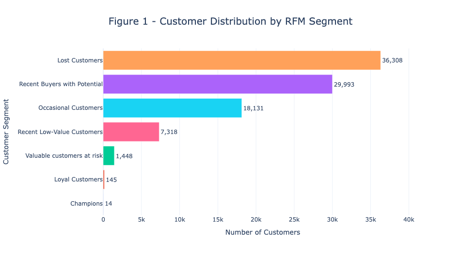
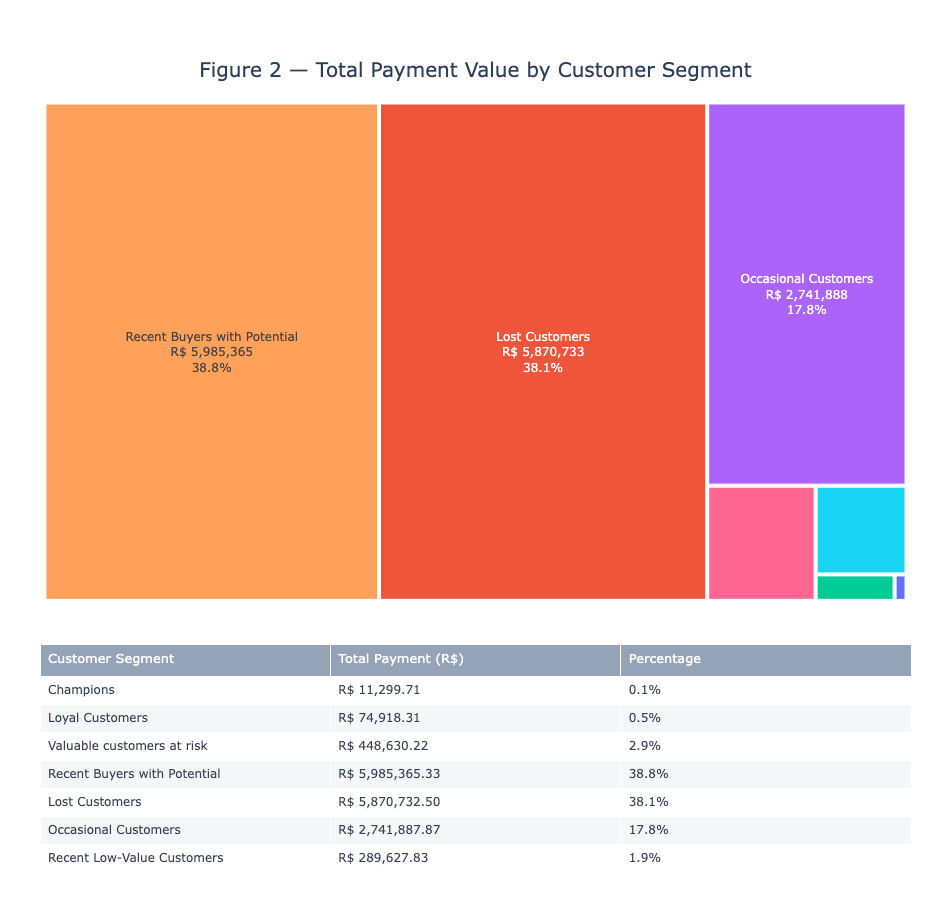
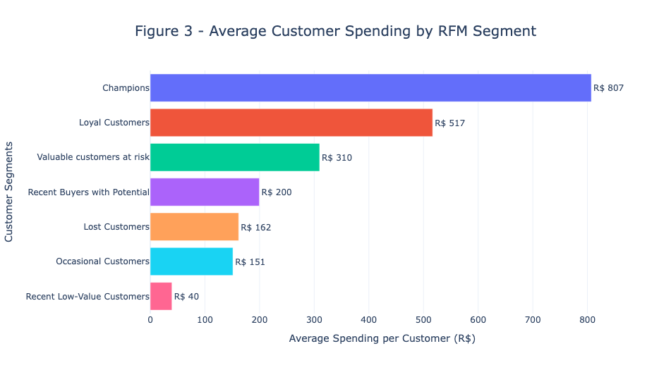

# Brazilian E-Commerce Customer Segmentation Using RFM Analysis

## Project Overview

This project explores customer purchasing behaviour in the **Brazilian E-Commerce Public Dataset by Olist** using **RFM analysis**: Recency (how recently customers purchased), Frequency (how often they purchased), and Monetary (how much they spent). The goal is to group customers by their historical purchasing behaviour and identify potential opportunities for customer retention and re-engagement.

The analysis covers data preparation, customer-level RFM scores, rule-based segmentation, visualisations, and interpretation of the results.

## Dataset

**Source:** [Brazilian E-Commerce Public Dataset by Olist (Kaggle)](https://www.kaggle.com/datasets/olistbr/brazilian-ecommerce)

The project uses the orders, customers, and order payments tables. Only **delivered orders** are included (96,478 of 99,441 orders, or 97.02%). Orders and customers are linked through `order_id` and `customer_id`; individual customers are identified using `customer_unique_id`.

## Tools and Libraries

- Python and pandas for data preparation, merging, aggregation, and RFM scoring
- Plotly for customer-segment visualisations
- Matplotlib and Seaborn for exploratory analysis
- Google Colab for notebook development
- KaggleHub for obtaining the dataset

## Methodology

1. **Prepare data:** Inspect tables, check missing values and duplicates, and select delivered orders.
2. **Calculate Recency:** Days since each customer's last purchase, relative to the latest purchase date in the filtered dataset. Score with five quantile-based groups, where 5 is most recent.
3. **Calculate Frequency:** Number of distinct purchases per customer. Use fixed score bands (`pd.cut`), since most customers made only one purchase and quantile-based grouping is unsuitable.
4. **Calculate Monetary:** Sum `payment_value` for each customer across delivered orders. Assign five quantile-based scores.
5. **Calculate RFM:** Merge Recency, Frequency, and Monetary metrics into a single DataFrame using `customer_unique_id`. Combine `R_code`, `F_code`, and `M_code` to create an individual `RFM_code` for each customer.
6. **Segment customers:** Apply rule-based classification criteria to assign customers to seven segments based on their RFM scores.

## Customer Segments

- Champions
- Loyal Customers
- Recent Buyers with Potential
- Valuable Customers at Risk
- Occasional Customers
- Lost Customers
- Recent Low-Value Customers

These labels are descriptive groups based on the chosen thresholds, not predictions of future behaviour.

## Key Findings

The final analysis covers **93,357 customers** with the required RFM information.

- **Repeat purchasing was uncommon.** Most customers placed only one order during the period analysed, helping explain the small loyal-customer segments.
- **Recent Buyers with Potential:** 29,993 customers (about 32% of the customer base) represented **38.8%** of the total payment value. Approximately **96.4%** of customers in this segment purchased only once. However, their relatively recent purchasing activity suggests an opportunity to engage them while their relationship with the business is still recent.
- **Lost Customers:** 36,308 customers (about 39% of the customer base) represented **38.1%** of historical payment value. Their average recency was approximately **394 days** relative to the dataset reference date.
- **Small loyal customer base:** the Champions and Loyal Customers segments included only **14** and **145** customers, respectively.

These findings describe past behaviour; they do not establish why individual customers did not return.

## Visualisations

The notebook includes five visualisations:

1. Customer distribution by RFM segment
   
   [View interactive chart](https://anakace.github.io/brazilian-ecommerce-rfm-analysis/interactive_charts/figure_1.html)
2. Total payment value by customer segment (treemap and accompanying table)
   
   [View interactive chart](https://anakace.github.io/brazilian-ecommerce-rfm-analysis/interactive_charts/figure_2.html)
3. Average spending per customer by RFM segment
   
   [View interactive chart](https://anakace.github.io/brazilian-ecommerce-rfm-analysis/interactive_charts/figure_3.html)
4. Average recency by RFM segment
   
5. Average number of purchases per customer by segment
   

**[Open the analysis notebook](brazilian_ecommerce_rfm.ipynb)** to explore the methodology, figures, and conclusions.

## How to Run

1. Open `brazilian_ecommerce_rfm.ipynb` in Google Colab.
2. Run the notebook from the first cell. It downloads the Olist dataset via KaggleHub.

## Limitations

The dataset covers a limited historical period, so customers described as lost or inactive may have bought again outside the observed period. RFM groups also depend on scoring thresholds and rule order. The analysis describes historical transactions but does not explain customer motivations or predict future purchases.

## Data Credit

Dataset provided by **Olist** and hosted on [Kaggle](https://www.kaggle.com/datasets/olistbr/brazilian-ecommerce).

